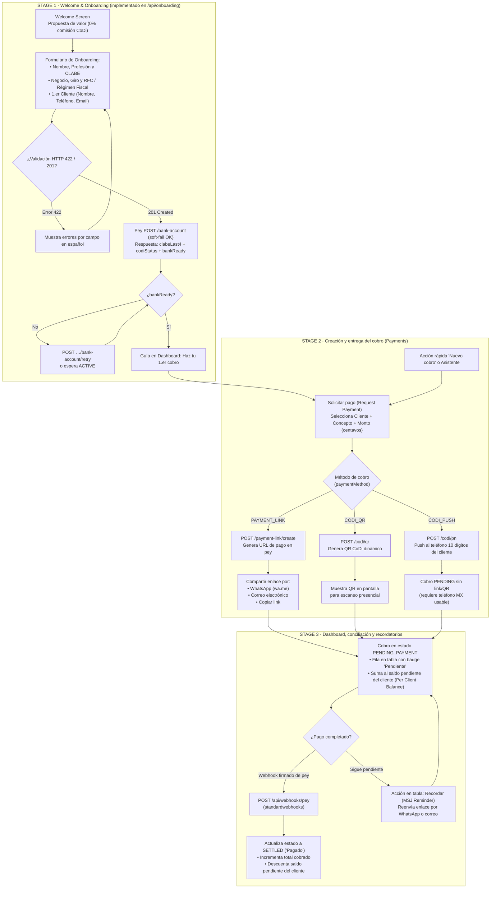
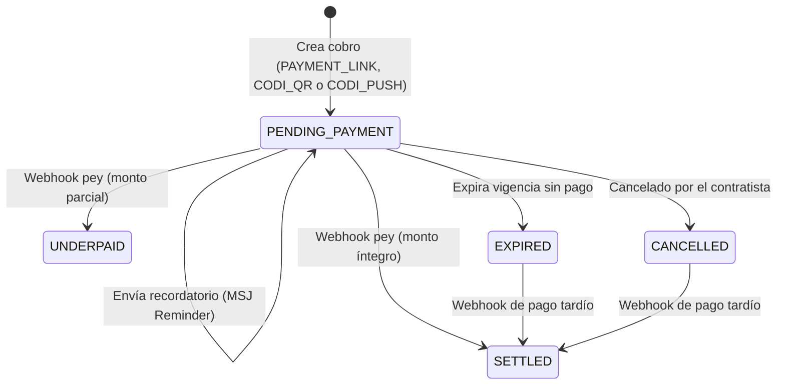

# Flujo funcional y módulos de pagos

Este documento define el flujo completo de la plataforma en tres etapas (`Stage 1`, `Stage 2` y `Stage 3`), alineado con la [arquitectura modular](architecture.md) del monorepo (`apps/backend`, `apps/frontend` y `packages/contracts`).

En esta iteración se soportan tres modalidades de cobro en `api.pey.mx`:
- **`PAYMENT_LINK`** (`POST /payment-link/create`): enlace de cobro alojado para enviar por WhatsApp, correo electrónico o copiar enlace.
- **`CODI_QR`** (`POST /codi/qr`): código QR CoDi dinámico para cobro presencial desde pantalla.
- **`CODI_PUSH`** (`POST /codi/pn`): push CoDi al teléfono de 10 dígitos del cliente guardado (sin QR ni enlace).

---

## 1. Diagrama general de flujo (Stages 1, 2 y 3)



---

## 2. Secuencia entre Frontend, Backend Go y `api.pey.mx`

```mermaid
sequenceDiagram
    autonumber
    actor P as Contratista / Profesional
    participant Web as Frontend (React + Vite)
    participant API as Backend (Go net/http)
    participant Pey as api.pey.mx (Payment Link / CoDi QR / CoDi Push)
    actor C as Cliente

    Note over P,C: Flujo A: Creación del cobro (Payment Link, CoDi QR o CoDi Push)
    P->>Web: Selecciona cliente, concepto y monto; elige PAYMENT_LINK, CODI_QR o CODI_PUSH
    Web->>API: POST /api/payments (CreatePaymentIntentRequest)
    API->>Pey: POST /payment-link/create, /codi/qr o /codi/pn (monto en pesos)
    Pey-->>API: Devuelve paymentLinkUrl, qrString+id, o transactionId
    API-->>Web: 201 PaymentIntentDto (status = PENDING_PAYMENT)
    Web->>C: Comparte link, presenta QR, o el cliente recibe el push CoDi
    Note over API,Pey: CODI_PUSH exige bankReady + teléfono guardado reducible a 10 dígitos MX

    Note over P,C: Flujo B: Recordatorio de pago (MSJ Reminder)
    P->>Web: Filtra por "Pendientes" y pulsa "Recordar"
    Web->>API: POST /api/payments/{id}/remind
    API-->>Web: Actualiza contador de recordatorios y devuelve enlace/mensaje
    Web->>C: Abre WhatsApp o correo con el recordatorio y el Payment Link

    Note over P,C: Flujo C: Conciliación vía webhook
    C->>Pey: Realiza el pago desde el enlace o escaneando el QR CoDi
    Pey->>API: POST /api/webhooks/pey (firma standardwebhooks)
    API->>API: Verifica firma + idempotencia (webhook-id) + cambia estado a SETTLED
    API-->>Web: Dashboard refleja badge "Pagado" y actualiza saldo del cliente
```

---

## 3. Máquina de estados del cobro (`PaymentStatusDto`)



### Reglas de interfaz en el Dashboard (`Stage 3`)
1. **Badges semánticos (texto + color):**
   - `SETTLED` → `Pagado`
   - `PENDING_PAYMENT` → `Pendiente`
   - `EXPIRED` → `Vencido`
   - `UNDERPAID` → `Incompleto`
   - `CANCELLED` → `Cancelado`
2. **Filtros de tabla:** `Todos`, `Pendientes`, `Completados` y `Vencidos`.
3. **Balance por cliente (`Per Client Balance`):** Calcula por cada cliente el monto total pagado (`settledAmountCents`) y el saldo pendiente (`pendingAmountCents`) a partir de sus cobros registrados.
4. **Representación monetaria:** Todos los montos en contratos e interfaz interna viajan en centavos enteros (`amountCents`) y se formatean con números tabulares (`font-variant-numeric: tabular-nums`).
